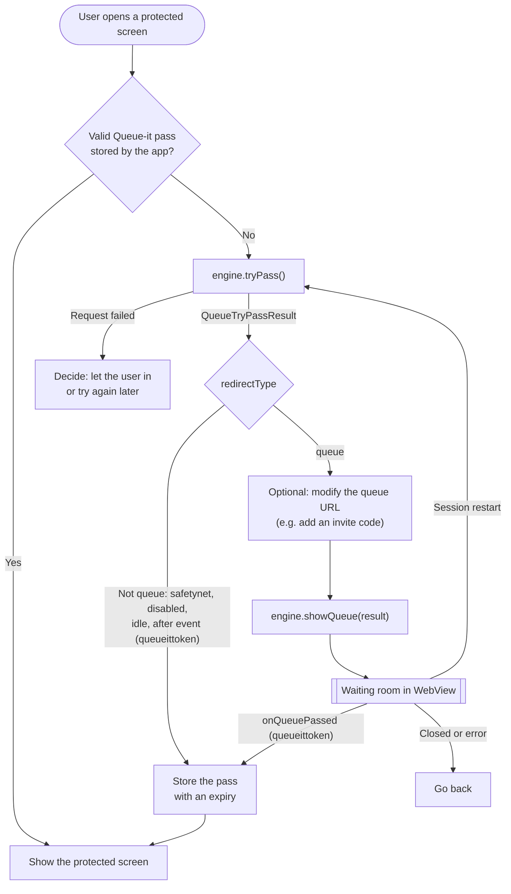
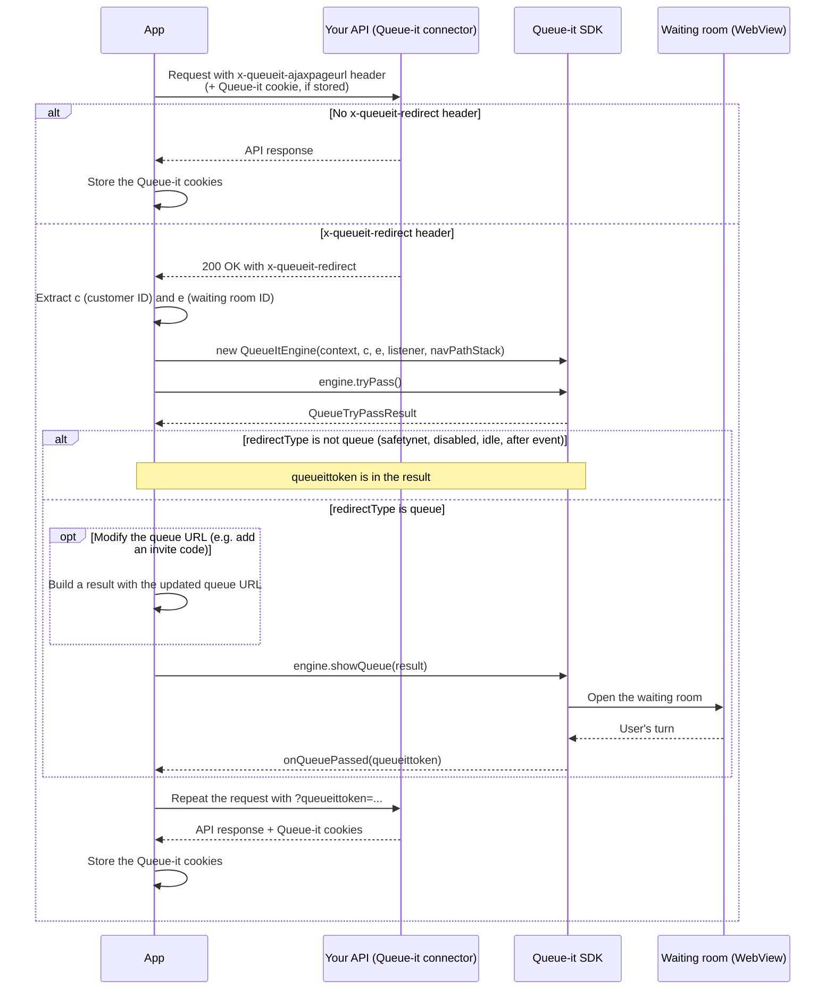

# Queue-it HarmonyOS ArkTS/ArkUI SDK

[//]: # (Add badges here when available, e.g., for HAR version or license)

Library for integrating Queue-it's virtual waiting room into a HarmonyOS Next application built with ArkTS and ArkUI.

This SDK is for the HarmonyOS Next ecosystem (API version 12 and higher).

## Installation

Before starting, please download the "Mobile App Integration" whitepaper from the GO Queue-it Platform. This document contains essential information for a successful integration.


```bash
ohpm install queueit-library
```

## Required Permissions

Add the following permissions to your application's `src/main/module.json5` file.

```json5
// src/main/module.json5
{
  "module": {
    // ... other module properties
    "requestPermissions": [
      {
        "name": "ohos.permission.INTERNET",
        "reason": "$string:internet_permission_reason",
        "usedScene": {
          "abilities": [ ".EntryAbility" ],
          "when": "inuse"
        }
      },
      {
        "name": "ohos.permission.GET_NETWORK_INFO",
        "reason": "$string:network_permission_reason",
        "usedScene": {
          "abilities": [ ".EntryAbility" ],
          "when": "inuse"
        }
      }
    ]
  }
}
```
*Remember to define `internet_permission_reason` and `network_permission_reason` in your `src/main/resources/base/element/string.json` file.*

## How to Use the Library

As the app developer, you must manage the state (i.e., whether the user was previously queued up). After receiving the `onQueuePassed` callback, your app should store this state, potentially with a date/time expiration. When the user navigates to a protected part of the app, your code should check this state and only trigger the Queue-it logic if the user has not recently passed the queue.

The integration uses two methods of `QueueItEngine`:
- `tryPass()` checks the status of the waiting room and returns a `QueueTryPassResult`.
- `showQueue(result)` shows the waiting room to the user, when the result says the user must queue.

Between the two calls your app decides when and where the waiting room is shown, and can change the queue URL if needed (see [Modify the queue URL before showing the waiting room](#3-modify-the-queue-url-before-showing-the-waiting-room)).



### 1. UI Integration using Navigation

The SDK uses HarmonyOS's `Navigation` component to present the queue page. Your page must be set up to host a `Navigation` container and provide the SDK with its `NavPathStack`.

The integration steps are:
1.  Wrap your page content in a `Navigation` component, providing it with an `@State NavPathStack`.
2.  When initializing `QueueItEngine`, pass this `NavPathStack` instance to its constructor.
3.  Define a destination builder for the `Navigation` component that maps the route name `'QueueView'` to the SDK's `<QueueView>` component.

Here is a complete example of the UI setup:

```typescript
// In your page

import { QueueItEngine, QueueITViewManager, QueueView } from 'queueit-library';

@Component
struct MyPage {
  // 1. Navigation state for your page
  @State navPathStack: NavPathStack = new NavPathStack();
  
  // 2. The SDK components. The view manager must be @State: QueueView links to it.
  private engine: QueueItEngine | null = null;
  @State queueViewManager: QueueITViewManager | null = null;

  async initializeSdk() {
    // ... (code to get context, define listener, etc.)

    // 3. Pass your NavPathStack to the engine
    this.engine = new QueueItEngine(
        context,
        customerId,
        eventId,
        listener,
        this.navPathStack // Pass the stack here
    );
    this.queueViewManager = this.engine.getWebViewManager();
  }

  // 4. Define the destination builder
  @Builder queueItMap(name: string) {
    if (name === 'QueueView') {
      // The view manager must be linked with '$'
      QueueView({ viewManager: $queueViewManager })
    }
  }
  
  build() {
    NavDestination() {
      // 5. Use the Navigation component as the container
      Navigation(this.navPathStack) {
        Column() {
          // Your page content (buttons, text, etc.) goes here
          Button('Enter Event').onClick(() => this.enterEvent()) // See section 2
        }
      }
      .navDestination(this.queueItMap) // Attach the builder
      .mode(NavigationMode.Auto)
    }
  }
}
```
When you call `showQueue()`, the SDK pushes the `QueueView` onto your `navPathStack`.

### 2. Integration with `tryPass()` and `showQueue()`

First check the user's status with `tryPass()`, then show the queue page with `showQueue()`.

```typescript
// In your page

import {
  QueueItEngine,
  QueueListener,
  QueuePassedInfo,
  QueueDisabledInfo,
  QueueError,
  QueueTryPassResult,
  QueueITApiClient
} from 'queueit-library';
import common from '@ohos.app.ability.common';
import promptAction from '@ohos.promptAction';

// ... inside your @Component struct (navPathStack, engine and queueViewManager as in section 1;
// customerIdInput, eventIdInput and isTestEnvironment are your own fields)
@State isLoadingSdk: boolean = false;

// 1. Define the listener to handle callbacks from the SDK
private createQueueListener(): QueueListener {
  return {
    onQueuePassed: (info: QueuePassedInfo) => {
      this.isLoadingSdk = false;
      this.queueViewManager?.hideQueue();
      // The user may continue: either the user's turn came in the waiting room, or tryPass()
      // returned a result that is not RedirectType.Queue (see below).
      // Store the pass (e.g. with an expiry) and navigate to your protected content.
      promptAction.showToast({ message: `Queue Passed! Token: ${info.queueItToken}` });
    },
    onQueueViewWillOpen: () => {
      this.isLoadingSdk = false;
    },
    onQueueDisabled: (info: QueueDisabledInfo) => {
      // Required by the interface, but not called in the tryPass() + showQueue() flow (see below)
      this.isLoadingSdk = false;
    },
    onQueueItUnavailable: () => {
      this.isLoadingSdk = false;
      this.queueViewManager?.hideQueue();
      promptAction.showToast({ message: 'Queue-it is unavailable. Please try again later.' });
    },
    onError: (error: QueueError, errorMessage: string) => {
      this.isLoadingSdk = false;
      this.queueViewManager?.hideQueue();
      promptAction.showToast({ message: `Critical error: ${errorMessage}` });
    },
    onWebViewClosed: () => {
      // The user closed the waiting room
      this.isLoadingSdk = false;
    },
    onSessionRestart: () => {
      // The user restarted the session from the waiting room: check the status again
      this.enterEvent();
    }
  };
}

// 2. Initialize the engine
private initializeSdkEngine(): void {
  const context = this.getUIContext()?.getHostContext() as common.Context;

  // Remember to pass the NavPathStack
  this.engine = new QueueItEngine(
      context,
      this.customerIdInput,
      this.eventIdInput,
      this.createQueueListener(),
      this.navPathStack
  );
  this.queueViewManager = this.engine.getWebViewManager();
}

// 3. Check the waiting room status, then show the queue page if needed
async enterEvent(): Promise<void> {
  if (!this.engine) {
    this.initializeSdkEngine();
  }

  QueueITApiClient.isTest = this.isTestEnvironment;
  this.isLoadingSdk = true;

  // Or tryPass(enqueueToken) / tryPass(undefined, enqueueKey)
  const result: QueueTryPassResult | null = await this.engine!.tryPass();
  if (!result) {
    // The request failed. The SDK has called onError or onQueueItUnavailable,
    // except when another request is already in progress (then no callback is made).
    this.isLoadingSdk = false;
    return;
  }

  // RedirectType.Queue: the user must queue. showQueue() pushes the QueueView onto the
  // navigation stack. You can modify the queue URL first, see section 3.
  // Any other result (safety net, disabled, idle, after event, ...) carries a queueittoken:
  // showQueue() does not show the queue page and calls onQueuePassed instead.
  this.engine!.showQueue(result);
}
```

`isPassedThrough` only tells you that the result has a queueittoken. A disabled, idle or after-event waiting room also returns a token, so it reaches `onQueuePassed` and `onQueueDisabled` is not called in this flow. If you need to tell these cases apart, check `result.redirectType` yourself instead of passing a non-queue result to `showQueue()`.

`hideQueue()` is used to close the queue page webview programmatically.

### 3. Modify the queue URL before showing the waiting room

After `tryPass()` returns a result with `redirectType` `RedirectType.Queue`, and before you call `showQueue()`, you can change the queue URL. For example, to send the visitor to an invite-only waiting room, add the invite code as the `code` query parameter. The SDK has no separate invite-code setting, so this is how you pass an invite code on HarmonyOS.

`QueueTryPassResult` is read-only. Create a new `QueueTryPassResult` with the same values and the updated `queueUrl`, and pass it to `showQueue()`. `showQueue()` loads the URL as given.

```typescript
import { QueueTryPassResult, RedirectType } from 'queueit-library';

function withInviteCode(result: QueueTryPassResult, inviteCode: string): QueueTryPassResult {
  const queueUrl: string | null = result.queueUrl;
  if (!queueUrl || queueUrl.includes('?code=') || queueUrl.includes('&code=')) {
    // No queue URL, or the URL already has an invite code: keep the result as it is
    return result;
  }

  let separator: string = '&';
  if (!queueUrl.includes('?')) {
    separator = '?';
  } else if (queueUrl.endsWith('?') || queueUrl.endsWith('&')) {
    separator = '';
  }

  return new QueueTryPassResult(
    result.queueItToken,
    `${queueUrl}${separator}code=${encodeURIComponent(inviteCode)}`,
    result.targetUrl,
    result.isPassedThrough,
    result.redirectType,
    result.urlTTLInMinutes
  );
}

// In enterEvent() (section 2), instead of this.engine!.showQueue(result):
this.engine!.showQueue(
  result.redirectType === RedirectType.Queue ? withInviteCode(result, inviteCode) : result
);
```

Only modify a result with `redirectType` `RedirectType.Queue`, and still pass every other result to `showQueue()`, so that `onQueuePassed` is called for it.

Only add or change query parameters. Keep the scheme, host and path of the queue URL: the SDK uses the queue host to decide which pages stay inside the waiting room WebView.

### 4. Handling the Back Button

The SDK handles back button presses while the `QueueView` shows the waiting room, based on the `disableBackButtonFromWR` option in `QueueItEngineOptions`:
- `true` (default): the back press is ignored, so the user stays in the waiting room.
- `false`: the back press is not consumed, and `Navigation` pops the queue page from your navigation stack.

No additional `onBackPressed` code is required from the consuming page.

### `QueueItEngineOptions`

You can configure the engine by passing an `options` object to the constructor.

```typescript
import { QueueItEngine, QueueItEngineOptions } from 'queueit-library';

const options = new QueueItEngineOptions();
// Disables the hardware/software back button while the queue view is shown
options.disableBackButtonFromWR = true; 
// Set a delay in milliseconds before the queue view is displayed
options.viewDelayMs = 500;

// layoutName and language are optional
const engine = new QueueItEngine(context, customerId, eventId, listener, navPathStack, undefined, undefined, options);
```

`QueueItEngineOptions` also has a `webViewUserAgent` field, but the SDK does not apply it yet: the WebView always uses its default user agent with the SDK version added.

## Integration with Connector Protected APIs

If your application calls an API protected by a Queue-it connector (KnownUser), you need to handle potential redirects from the API layer.

The flow is as follows:
1.  **Make API Request**: Your app makes a standard API request.
2.  **Catch `MustBeQueuedError`**: If the user needs to be queued, your API client should throw a specific error containing the redirect URL from the `x-queueit-redirect` header.
3.  **Handle Redirect**: In your UI logic, catch this error.
4.  **Parse IDs**: Extract the Customer ID (`c`) and Event ID (`e`) from the redirect URL.
5.  **Show the Waiting Room**: Instantiate a new `QueueItEngine` with the parsed IDs and your page's `NavPathStack`. Call `tryPass()`, then pass the result to `showQueue()`. For `RedirectType.Queue` it shows the queue view; any other result already carries a queueittoken, and `showQueue()` calls `onQueuePassed` with it.
6.  **Retry API Call**: In the `onQueuePassed` callback, store the new `queueItToken` and retry the original API request. This time, your API client should include the token with the request.



Your API client throws an error type of your own when the response has the `x-queueit-redirect` header, for example:

```typescript
// MustBeQueuedError.ets
export class MustBeQueuedError extends Error {
  public redirectUrl: string;

  constructor(redirectUrl: string) {
    super(`Must be queued. Redirect to: ${redirectUrl}`);
    this.redirectUrl = redirectUrl;
    this.name = 'MustBeQueuedError';
  }
}
```

Then, in your page:

```typescript
import {
  QueueItEngine,
  QueueListener,
  QueuePassedInfo,
  QueueDisabledInfo,
  QueueError,
  QueueTryPassResult
} from 'queueit-library';
import { MustBeQueuedError } from './MustBeQueuedError';
import common from '@ohos.app.ability.common';
import url from '@ohos.url';

// ... inside your @Component struct (navPathStack and queueViewManager as in section 1).
// productRepository is your API client: it adds the queueittoken to the next request.

async fetchProduct(): Promise<void> {
  try {
    const product = await this.productRepository.getProduct();
    // Handle successful fetch
  } catch (e) {
    if (e instanceof MustBeQueuedError) {
      // Trigger the queueing logic
      await this.handleQueueRedirect(e.redirectUrl);
    } else {
      // Handle other errors
    }
  }
}

private async handleQueueRedirect(redirectUrl: string): Promise<void> {
  try {
    const parsedUrl = url.URL.parseURL(decodeURIComponent(redirectUrl));
    const customerId: string | null = parsedUrl.params.get('c');
    const eventId: string | null = parsedUrl.params.get('e');
    if (!customerId || !eventId) {
      // Not a valid Queue-it redirect
      return;
    }

    const context = this.getUIContext()?.getHostContext() as common.Context;

    // Create a temporary engine to handle this specific redirect
    const redirectEngine = new QueueItEngine(context, customerId, eventId,
      this.createQueueRedirectListener(), this.navPathStack);

    // Assign its manager to the UI state to make the QueueView's NavDestination work
    this.queueViewManager = redirectEngine.getWebViewManager();

    const result: QueueTryPassResult | null = await redirectEngine.tryPass();
    if (result) {
      // RedirectType.Queue: shows the queue view (you can modify the queue URL first, see section 3).
      // Any other result carries a queueittoken: showQueue() calls onQueuePassed instead.
      redirectEngine.showQueue(result);
    }
  } catch (e) {
    // Handle parsing errors
  }
}

// The listener for this flow
private createQueueRedirectListener(): QueueListener {
  return {
    onQueuePassed: (info: QueuePassedInfo) => {
      // Add the new token to the repository for the next API call, then retry the original request
      this.productRepository.addQueueToken(info.queueItToken);
      this.fetchProduct();
    },
    onQueueViewWillOpen: () => {},
    onQueueDisabled: (info: QueueDisabledInfo) => {
      // Not called in the tryPass() + showQueue() flow
    },
    onQueueItUnavailable: () => {
      this.queueViewManager?.hideQueue();
      // Decide whether to let the request through or show an error
    },
    onError: (error: QueueError, errorMessage: string) => {
      this.queueViewManager?.hideQueue();
      // Show an error
    }
  };
}
```

## License

This SDK is licensed under the MIT License. See the `LICENSE` file for details.